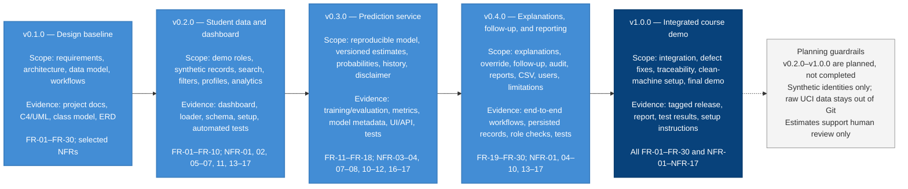

# Incremental Development Plan

**Project:** AI Student Success and Dropout-Risk Support System (Group 02)  
**Planning basis:** project brief, `docs/requirements.md`, `docs/architecture.md`, `docs/use_cases.md`, and the existing UML/design artifacts.

**Visual plan:** [Mermaid diagram source](../uml/incremental_development_plan.mmd).

This is a staged implementation plan. The design increment is already represented by committed planning/design artifacts; application increments below are planned and must not be marked complete until implemented and reviewed. Each implementation increment is expected to have automated tests that pass before its pull request is merged (NFR-16).

| Version | Type | Capacity / Scope | Deliverable / Evidence | Requirements / Design Links |
|---|---|---|---|---|
| v0.1.0-design | Design baseline | Define scope, actors, requirements, architecture, data model, key workflows, and initial traceability before implementation. | `docs/project_description.md`, `docs/requirements.md`, `docs/architecture.md`, `docs/use_cases.md`; C4, use case, sequence, activity, class, and ERD sources under `uml/`. | FR-01–FR-30; NFR-01, NFR-04–NFR-12, NFR-15–NFR-17; `docs/traceability_matrix.md`; `uml/c4_context.drawio`, `uml/c4_container.drawio`, `uml/use_case.puml`, `uml/sequence_diagram.puml`, `uml/activity_diagram.puml`, `uml/class_diagram.drawio`, `uml/erd.drawio`. |
| v0.2.0-data-dashboard | Working increment 1: student data and dashboard | Establish runnable app, documented setup, demo sign-in/roles, synthetic data loading, student list/search/filter/profile, and baseline outcome analytics. No live student data. | Runnable dashboard; documented data preparation/loading script and synthetic identity generation; database schema and seed/demo data; automated tests and setup notes. | FR-01–FR-10; NFR-01, NFR-02, NFR-05–NFR-07, NFR-11, NFR-13–NFR-17; `docs/architecture.md` dashboard/API/database; class diagram and ERD; use case “Review Student Records and Dashboard Analytics.” |
| v0.3.0-prediction | Working increment 2: prediction service | Reproducible offline training/evaluation, versioned model publication, advisor-only estimate request, probabilities, generation time, model version, history, and visible decision-support notice. Handle invalid input or unavailable model safely. | Training/evaluation scripts and documented dataset/preprocessing/seed; evaluation report (macro-F1, per-class recall, confusion matrix); versioned model metadata; prediction API/UI; persisted history; automated tests. | FR-11–FR-18; NFR-03–NFR-04, NFR-07–NFR-08, NFR-10–NFR-12, NFR-16–NFR-17; prediction sequence diagram; `docs/architecture.md` model preparation and prediction service. |
| v0.4.0-support-reporting | Working increment 3: explanations, follow-up, administration, and reports | Individual and global explanations; advisor override/dismiss with reason; follow-up creation/status/history; administrator cohort reports, CSV export, account management, audit log, and limitations page. | End-to-end workflows; documented explanation method and limitations; persisted audit/follow-up records; report export; role checks; automated tests and demonstration evidence. | FR-19–FR-30; NFR-01, NFR-04–NFR-10, NFR-13–NFR-17; use cases and activity diagram; class diagram/ERD; `docs/architecture.md`. |
| v1.0.0-course-demo | Release / integration | Integrate the three working increments, resolve defects, verify traceability, prepare reproducible clean-machine setup and final demonstration/report. | Tagged release; final report and test evidence; installation/run instructions; reviewed requirements-to-design/code/test traceability; demo using synthetic identities only. | All FR-01–FR-30 and NFR-01–NFR-17; all design artifacts; `docs/testing.md`, `docs/report.md`, README. |

## Increment acceptance and status

- **Current status:** design baseline documented; implementation increments are planned. This plan does not claim that the application increments have been implemented.
- For each working increment, update the traceability matrix with actual module paths and test identifiers, run its automated tests, record review findings, and link the merged work or release evidence.
- Keep the raw UCI dataset and real student personal data out of the repository. Use only synthetic identities in the application and demonstration outputs.
- Keep estimates as decision support. They must not trigger automated student decisions, interventions, or notifications.
- If implementation scope or architecture changes, update this plan, requirements-to-design links, and related diagrams together.

## Mermaid Diagram

The following flowchart summarizes the planned increments. The release and integration stage follows the three working increments.

